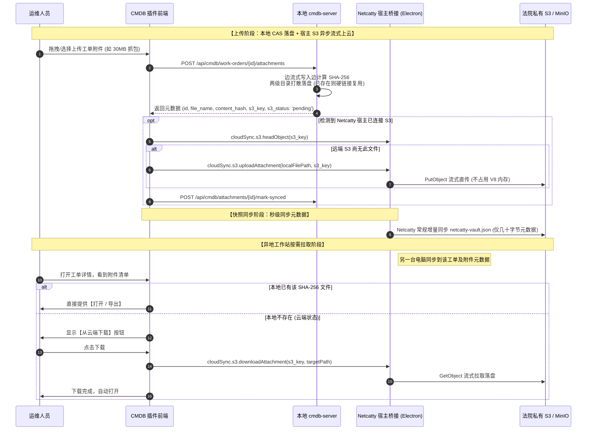

# Netcatty CMDB 附件内容寻址（CAS）与 Netcatty S3 双轨同步实施方案

> **项目名称**：常州中级人民法院 Netcatty CMDB 资产管理平台  
> **实施目标**：利用内容寻址存储（CAS）重构工单附件存储机制，直接复用 Netcatty 宿主已连接的私有 S3 对象存储通道，实现“元数据秒级同步 + 附件流式云端按需存取”。

---

## 1. 背景与核心问题

1. **现状**：
   - 现有的轻量级资产照片（Base64）随 `CmdbSyncSnapshot` 快照同步，运行良好；
   - 工单大附件（最高 50MB 的现场拓扑、配置导出、抓包日志）保存在单机本地磁盘目录，未纳入云端同步。
2. **瓶颈**：
   - 若将 50MB 级别的大文件直接编入 `netcatty-vault.json` 快照中，会导致 V8 内存溢出（OOM）、同步延迟严重甚至宿主崩溃；
   - 必须将**“结构体元数据同步”**与**“大体积二进制文件同步”**彻底解耦。
3. **策略**：
   - **零重复配置**：不要求用户在 CMDB 里二次填写 S3 密钥，直接复用 Netcatty 宿主现成的 S3 桥接器；
   - **内容寻址去重（CAS）**：按 SHA-256 哈希命名和存储，彻底杜绝操作系统中文编码乱码，实现跨工单秒传去重；
   - **双轨流式传输**：元数据进轻量快照，实体附件走 S3 流式分块传输。

---

## 2. 存储与命名规范设计

### 2.1 S3 远端存储规范（与 Netcatty 核心快照目录隔离）

Netcatty 配置 S3 时允许用户指定前缀（`prefix`，如 `czfy-court`）：

```text
S3 Bucket 根目录
├── [czfy-court]/
│   ├── netcatty-vault.json                         <-- Netcatty 原生轻量快照（资产与工单元数据）
│   └── attachments/                                <-- CMDB 工单附件专用目录
│       └── [sha256:0:2]/
│           └── [sha256:2:4]/
│               └── [sha256].bin                    <-- 二进制内容寻址文件（分两级打散）
```

- **示例**：文件 SHA-256 为 `a1b2c3d4e5f67890abcdef1234567890abcdef12...`
  - S3 Object Key: `czfy-court/attachments/a1/b2/a1b2c3d4e5f67890abcdef1234567890abcdef12.bin`

### 2.2 本地工作站落盘规范（Local Cache）

- **Windows**: `%APPDATA%\netcatty\cmdb-storage\attachments\a1\b2\a1b2c3d4....bin`
- **Linux**: `~/.config/netcatty/cmdb-storage/attachments/a1/b2/a1b2c3d4....bin`

---

## 3. 总体架构与数据流转



---

## 4. 详细实施执行计划

### 阶段一：后端数据库与存储层 CAS 重构（Go 后台）

- [ ] **1.1 数据表迁移与模型扩充（`internal/store`）**
  - 在 `cmdb_work_order_attachments` 数据表中新增字段：
    - `content_hash TEXT NOT NULL DEFAULT ''`：文件 SHA-256 指纹；
    - `s3_key TEXT NOT NULL DEFAULT ''`：S3 相对对象路径；
    - `s3_status TEXT NOT NULL DEFAULT 'pending'`：状态枚举（`pending` / `synced` / `failed`）；
  - 编写 SQLite 启动迁移（Migration），自动为旧数据补充默认字段。
- [ ] **1.2 分片哈希落盘算法实现**
  - 修改 `SaveWorkOrderAttachmentForProject`：
    - 引入 `io.TeeReader` 同时写入临时文件并计算 SHA-256；
    - 计算完成后重命名为 `attachments/<hash[:2]>/<hash[2:4]>/<hash>.bin`；
    - 若物理文件已存在，直接删除临时文件并复用现有文件，数据库新增工单引用（物理秒传去重）。
- [ ] **1.3 状态同步与存在性探测 API**
  - 新增 `GET /api/cmdb/attachments/hash/{hash}/status`：检查本地是否已有该哈希的物理文件；
  - 新增 `POST /api/cmdb/attachments/{id}/sync-status`：更新 S3 状态为 `synced`。

### 阶段二：Netcatty 宿主 Electron 桥接层流式 S3 扩展

- [ ] **2.1 扩展 IPC 处理器（`build/netcatty-final/electron/bridges/cloudSyncBridge.cjs`）**
  - 增加通用的 S3 对象流处理方法（复用已建立的 `buildS3Client`）：
    - `netcatty:cloudSync:s3:headObject({ key })`：检查对象是否存在；
    - `netcatty:cloudSync:s3:uploadAttachment({ localFilePath, key })`：通过 `fs.createReadStream` 和 `PutObjectCommand` 实现内存零拷贝流式上云；
    - `netcatty:cloudSync:s3:downloadAttachment({ key, targetFilePath })`：通过 `GetObjectCommand` 流式写入本地缓存；
    - `netcatty:cloudSync:s3:getStatus()`：获取当前宿主是否已启用并连接 S3 及其配置前缀。
- [ ] **2.2 Preload API 注入（`build/netcatty-final/electron/preload/preload.cjs`）**
  - 向 `window.netcatty.cloudSync` 暴露 S3 附件流接口，供 CMDB 插件无缝调用。

### 阶段三：前端界面与全自动补传/按需拉取闭环

- [ ] **3.1 工单附件卡片改造（`modules/workorders/`）**
  - 附件列表项增加云状态感知徽章：
    - `已本地就绪`：直接提供预览与下载；
    - `已同步至 S3`：带有云端标识；
    - `仅在云端（待拉取）`：显示大小与下载按钮，点击触发进度条流式拉取。
- [ ] **3.2 静默后台补传队列（Offline-First Sync）**
  - 前端监听 Netcatty 的 `netcatty:cloudSync:statusChanged` 事件；
  - 一旦 S3 连通，自动检索状态为 `pending` 的附件，逐个在后台静默上云并标记为 `synced`，实现断网离线操作、联网自动对齐。

### 阶段四：全平台与容灾验收测试

- [ ] **4.1 大文件吞吐与内存稳定性测试**
  - 连续上传 3 个 40MB 抓包文件，观察 Netcatty 内存曲线（保持平稳，无 GC 抖动或卡死）。
- [ ] **4.2 跨机器秒级去重测试**
  - 机器 A 上传固件包 `firmware-v2.bin`，机器 B 也上传完全相同的包；
  - 验证 S3 上只发生一次 `PutObject`，第二次上传秒级完成。
- [ ] **4.3 跨平台双向兼容性测试**
  - 在 Windows 工作站上传附件并同步至 S3；
  - 在国产 Linux（统信 UOS / 银河麒麟）上打开工单并拉取，验证文件名中文还原无乱码、SHA-256 完全一致。

---

## 5. 预期交付物

1. **后端更新**：`internal/store/work_order_attachments.go`（CAS 内容寻址改造）；
2. **宿主桥接更新**：`electron/bridges/cloudSyncBridge.cjs`（S3 流式接口扩展）；
3. **前端交互更新**：`modules/workorders/`（云状态标识与按需拉取）；
4. **插件包发布**：更新打包脚本，打包出全平台兼容且具备附件 S3 同步能力的 `.ncpkg` 独立插件。
