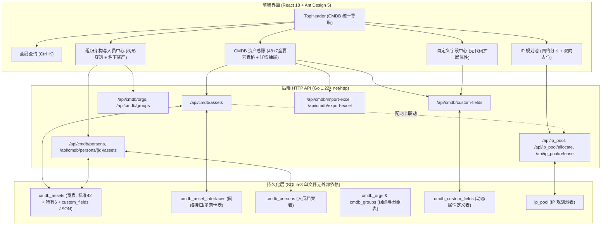

# CMDB 全要素与组织人员深度重构工程实施蓝图 (Detailed Implementation Plan)

> **版本**：v3.0.0-CMDB  
> **创建时间**：2026-09-16  
> **执行模式**：TDD / 阶段递进式落地  

---

## 目录
1. [系统总体架构与数据流](#1-系统总体架构与数据流)
2. [数据字典与 Schema 扩充详细规格](#2-数据字典与-schema-扩充详细规格)
3. [分阶段任务清单 (Task Breakdown)](#3-分阶段任务清单-task-breakdown)
   - [Task 1: 全局品牌彻底净化（剔除“中院”前缀）](#task-1-全局品牌彻底净化剔除中院前缀)
   - [Task 2: SQLite Schema 迁移与数据结构扩展（Go 后端）](#task-2-sqlite-schema-迁移与数据结构扩展go-后端)
   - [Task 3: 组织架构与人员（Person）后端 API 及资产穿透](#task-3-组织架构与人员person后端-api-及资产穿透)
   - [Task 4: 自定义字段（Custom Fields）动态元数据引擎（Go 后端）](#task-4-自定义字段custom-fields动态元数据引擎go-后端)
   - [Task 5: 资产 48+7 宽表读写、多网卡与 IP 规划池双向占位联动](#task-5-资产-487-宽表读写多网卡与-ip-规划池双向占位联动)
   - [Task 6: 前端导航重构与组织/人员管理模块实现](#task-6-前端导航重构与组织人员管理模块实现)
   - [Task 7: 前端自定义字段管理与动态表单/列渲染](#task-7-前端自定义字段管理与动态表单列渲染)
   - [Task 8: 前端 CMDB 资产总账（48+7 抽屉、多网卡及全要素表格）](#task-8-前端-cmdb-资产总账487-抽屉多网卡及全要素表格)
   - [Task 9: IP 规划池（IPAM）网络分区与关联资产穿透增强](#task-9-ip-规划池ipam网络分区与关联资产穿透增强)
   - [Task 10: 符合图片模板的 Excel 批量导入导出适配与全量集成测试](#task-10-符合图片模板的-excel-批量导入导出适配与全量集成测试)
4. [风险预案与回滚机制](#4-风险预案与回滚机制)

---

## 1. 系统总体架构与数据流

---

## 2. 数据字典与 Schema 扩充详细规格

### 2.1 资产主表 `cmdb_assets` 全要素字段规格（共 48 核心列 + 1 动态 JSON 列）

| 字段名 | 类型 | 来源分类 | 说明与约束 |
| :--- | :--- | :--- | :--- |
| `id` | INTEGER | 系统 | 主键自增 |
| `name` | TEXT | 图片1(*) | 资产名称 (必填) |
| `asset_class` | TEXT | 图片1(*) | 资产大类 (physical/virtual/desktop/network/storage) |
| `status` | TEXT | 图片1 | 运行状态 (在用/闲置/维保/报废/下线) |
| `device_type` | TEXT | 图片1(*) | 设备分类 (如: 刀片服务器, 虚拟机, 接入交换机) |
| `sn` | TEXT | 图片1 | 设备物理/虚拟序列号 |
| `manage_ip` | TEXT | 图片1 | 带内/主管理 IP |
| `mac_address` | TEXT | 图片1 | 主管理 MAC 地址 |
| `vendor` | TEXT | 图片1 | 厂商 (如: 浪潮, 华为, 联想, 深信服) |
| `model` | TEXT | 图片1 | 规格型号 (如: NF5280M6) |
| `organization` | TEXT | 图片1 | 所属组织名称 |
| `group_name` | TEXT | 图片1 | 所属分组名称 |
| `department` | TEXT | 图片1 | 部门名称 |
| `owner` | TEXT | 图片1 | 负责人/使用人姓名 |
| `area` | TEXT | 图片1 | 数据中心/机房区域 (如: 主机房A区) |
| `floor` | TEXT | 图片1 | 楼层 (如: 3F, 4F) |
| `cabinet_name` | TEXT | 图片1 | 机柜名称 (如: A01, B03) |
| `cabinet_pos` | TEXT | 图片1 | 机柜相对位置或行列 (如: Row-1-Col-2) |
| `u_height` | INTEGER | 图片1 | 设备占用高度(U)，默认 1 |
| `u_start` | INTEGER | 图片1 | 起始 U 位编号 (如: 12) |
| `port_count` | INTEGER | 图片1 | 物理端口总数 |
| `power_type` | TEXT | 图片1 | 电源类型 (AC/DC) |
| `redundant_power`| INTEGER | 图片1 | 是否冗余电源 (1=是, 0=否) |
| `purchase_at` | TEXT | 图片1 | 安装/投产日期 (YYYY-MM-DD) |
| `warranty_at` | TEXT | 图片1 | 保修截止日期 (YYYY-MM-DD) |
| `os_type` | TEXT | 图片1 | 操作系统类型 (统信UOS, 银河麒麟, CentOS, Windows) |
| `os_version` | TEXT | 图片1 | 操作系统版本号 (如: V20 1060, SP3) |
| `tags` | TEXT | 图片1 | 标签键值对 (分号分隔: env:prod;sec:l3) |
| `description` | TEXT | 图片1 | 资产备注与详细描述 |
| `country` | TEXT | 图片1 | 国家 (默认: 中国) |
| `province` | TEXT | 图片1 | 省份 (如: 江苏省) |
| `city` | TEXT | 图片1 | 城市 (如: 常州市) |
| `district` | TEXT | 图片1 | 区县 (如: 新北区) |
| `longitude` | REAL | 图片1 | 地理经度数字 |
| `latitude` | REAL | 图片1 | 地理纬度数字 |
| `geo_address` | TEXT | 图片1 | 地理物理详细地址 |
| `provider` | TEXT | 图片1 | 云厂商/供应商 (私有云/阿里云/华为云) |
| `region` | TEXT | 图片1 | 地域 (如: cn-east-2) |
| `zone` | TEXT | 图片1 | 可用区 (如: zone-a) |
| `vcpu` | INTEGER | 图片1 | CPU 核心数 |
| `memory_mb` | INTEGER | 图片1 | 内存大小(MB) |
| `instance_type` | TEXT | 图片1 | 云实例规格 (如: ecs.c6.2xlarge) |
| `public_ip` | TEXT | 图片1 | 公网/外网 IP |
| **`asset_code`** | TEXT | 现有融合 | 统一资产固定编码 (如: ZC-2026-001) |
| **`box_sn`** | TEXT | 现有融合 | 云桌面盒子 SN |
| **`display_sn`**| TEXT | 现有融合 | 显示器独立 SN |
| **`cpu_info`** | TEXT | 现有融合 | CPU 详细型号 (如: 鲲鹏920 64核) |
| **`disk_info`**| TEXT | 现有融合 | 存储/磁盘配置 (如: 2*480G SSD + 4*4TB SAS) |
| **`mgmt_url`** | TEXT | 现有融合 | 带外 BMC/iLO 控制台 Web 访问地址 |
| **`biz_ip`** | TEXT | 现有融合 | 核心业务通信 IP |
| **`rack_unit`** | TEXT | 现有融合 | 快速机架表示 (如: A02-12U) |
| **`security_software`** | TEXT | 现有融合 | 安全桌管软件安装状态 (如: 火绒+EDR已装) |
| **`net_type`** | TEXT | 现有融合 | 网络密级/网络类型 (业务专网/互联网/涉密网) |
| **`admin_user`**| TEXT | 现有融合 | 运维管理员姓名 |
| **`room`** | TEXT | 现有融合 | 具体房间号/工位号/法庭号 |
| **`owner_id`** | INTEGER | 组织联动 | 关联的人员 ID (`cmdb_persons.id`) |
| **`custom_fields`**| TEXT | 自定义引擎 | 动态自定义属性的 JSON 字典 |

### 2.2 网络接口表 `cmdb_asset_interfaces`（对齐图片 2 + 扩展）
- `id` INTEGER PRIMARY KEY AUTOINCREMENT
- `asset_id` INTEGER NOT NULL (关联 `cmdb_assets.id`)
- `asset_name` TEXT NOT NULL (图片2: 资产名称关联键)
- `name` TEXT NOT NULL (图片2: 接口名称，如 eth0, bond0)
- `ip` TEXT (图片2: IP地址)
- `mask` TEXT (图片2: 掩码/前缀，如 255.255.255.0 或 /24)
- `gateway` TEXT (图片2: 默认网关)
- `network_zone` TEXT (图片2: 网络分区，如 业务专网7段, DMZ区)
- `is_primary` INTEGER NOT NULL DEFAULT 0 (图片2: 是否主接口 1/0)
- `vlan_id` INTEGER NOT NULL DEFAULT 0 (补充: VLAN ID)
- `mac` TEXT (补充: 网卡独立 MAC 地址)

### 2.3 人员档案表 `cmdb_persons`
- `id` INTEGER PRIMARY KEY AUTOINCREMENT
- `person_code` TEXT (工号/员工编号)
- `name` TEXT NOT NULL (姓名)
- `org_name` TEXT (所属组织)
- `group_name` TEXT (所属分组)
- `department` TEXT NOT NULL (部门)
- `title` TEXT (职位/岗位)
- `phone` TEXT (联系电话)
- `email` TEXT (邮箱)
- `status` TEXT NOT NULL DEFAULT '在职' (在职/离职/调休)
- `remark` TEXT (备注)

### 2.4 自定义字段定义表 `cmdb_custom_fields`
- `id` INTEGER PRIMARY KEY AUTOINCREMENT
- `field_key` TEXT NOT NULL UNIQUE (字段英文Key，如 `env_level`)
- `field_name` TEXT NOT NULL (字段中文名，如 `环境等级`)
- `field_type` TEXT NOT NULL (text, number, select, date, boolean)
- `options_json` TEXT (下拉单选时的候选项数组 JSON)
- `asset_class` TEXT NOT NULL DEFAULT 'all' (适用资产分类)
- `required` INTEGER NOT NULL DEFAULT 0 (是否必填)
- `show_in_list` INTEGER NOT NULL DEFAULT 1 (是否默认在列表展示)
- `export_excel` INTEGER NOT NULL DEFAULT 1 (是否导出为 Excel 独立列)
- `sort_order` INTEGER NOT NULL DEFAULT 0

---

## 3. 分阶段任务清单 (Task Breakdown)

### Task 1: 全局品牌彻底净化（剔除“中院”前缀）
- **目标**：全方位更名为「CMDB」，前端标题、导航栏、模板提示词、后端服务日志中不遗留任何中院相关前缀。
- **涉及文件**：
  - `web/index.html`：`<title>CMDB 资产管理平台</title>`
  - `web/src/modules/shell/TopHeader.jsx`：修改 brand 文本为 `<strong>CMDB</strong><small>资产管理平台</small>`
  - `web/src/ShellPreview.jsx`：清理 brand 文本
  - `web/src/CMDBResources.jsx` / `AssetCenter.jsx`：清理中院文字
- **验收命令**：
  - 执行 `git grep "中院"` 检查输出，确保业务文本已彻底清理。

### Task 2: SQLite Schema 迁移与数据结构扩展（Go 后端）
- **目标**：扩展 `cmdb_assets`、`cmdb_asset_interfaces`，新建 `cmdb_persons` 和 `cmdb_custom_fields` 表，具备向后平滑兼容性。
- **涉及文件**：
  - `internal/store/cmdb_schema.go`：更新 DDL 定义
  - `internal/store/cmdb_migrate.go`（新建）：编写数据库启动时的补列和建表迁移函数 `MigrateCMDBFullSchema(db *sql.DB) error`
  - `internal/store/store.go`：在 `Open()` 启动时自动执行迁移
- **验证方式**：
  - 编写并运行 `go test ./internal/store -run TestMigrateCMDBFullSchema`，确保全新库与老库升级均成功。

### Task 3: 组织架构与人员（Person）后端 API 及资产穿透
- **目标**：实现人员增删改查、部门/分组树状聚合统计、人员名下资产关联查询以及一键资产交接。
- **涉及文件**：
  - `internal/store/person_store.go`（新建）：实现 `ListPersons`、`CreatePerson`、`UpdatePerson`、`DeletePerson`、`GetPersonAssets`、`TransferPersonAssets`
  - `internal/server.go`：挂载对应 HTTP 路由：
    - `GET /api/cmdb/persons`
    - `POST /api/cmdb/persons`
    - `PUT /api/cmdb/persons/{id}`
    - `DELETE /api/cmdb/persons/{id}`
    - `GET /api/cmdb/persons/{id}/assets`
    - `POST /api/cmdb/persons/transfer`
- **验证方式**：
  - 单元测试覆盖人员创建、绑定资产、查询资产列表和资产转移。

### Task 4: 自定义字段（Custom Fields）动态元数据引擎（Go 后端）
- **目标**：实现自定义字段定义管理与校验。
- **涉及文件**：
  - `internal/store/custom_field_store.go`（新建）：`ListCustomFields`、`SaveCustomField`、`DeleteCustomField`
  - `internal/server.go`：挂载：
    - `GET /api/cmdb/custom-fields`
    - `POST /api/cmdb/custom-fields`
    - `DELETE /api/cmdb/custom-fields/{id}`
- **验证方式**：
  - API 测试：添加下拉单选字段与文本字段，读取时格式符合规范。

### Task 5: 资产 48+7 宽表读写、多网卡与 IP 规划池双向占位联动
- **目标**：重构资产主表与网卡表的读写逻辑，打通 IP 规划池联动。
- **业务逻辑约束**：
  - 保存网卡时，若 IP 在 `ip_pool` 中存在且为“空闲”，自动将其置为“已分配”，记录 `asset_id` 与 `asset_name`；
  - 若修改网卡移除了某个 IP 或资产报废时，自动将 IP 释放为空闲状态；
  - 资产主表接收 `custom_fields` 字典并验证入库。
- **涉及文件**：
  - `internal/store/cmdb_store.go`
  - `internal/store/cmdb_write.go`
  - `internal/store/ippool_store.go`
- **验证方式**：
  - 编写集成测试用例：新增资产分配 IP，验证 `ip_pool` 状态联动变化。

### Task 6: 前端导航重构与组织/人员管理模块实现
- **目标**：在 AntD 5 下构建全新【组织与人员】模块，支持人员花名册、名下资产穿透抽屉与资产批量交接。
- **涉及文件**：
  - `web/src/modules/shell/TopHeader.jsx`：主导航添加【组织与人员】、【自定义字段】
  - `web/src/modules/org/OrgPersonCenter.jsx`（新建）：组织架构与人员管理主页
  - `web/src/modules/org/PersonAssetDrawer.jsx`（新建）：人员名下关联资产抽屉与一键转交
  - `web/src/App.jsx`：挂载新主视图路由
- **验证方式**：
  - 浏览器点击人员姓名，弹出抽屉正确渲染名下 PC、服务器、虚拟机卡片。

### Task 7: 前端自定义字段管理与动态表单/列渲染
- **目标**：实现无代码字段管理控制台，以及在资产表单和主列表中的动态注入。
- **涉及文件**：
  - `web/src/modules/customfields/CustomFieldCenter.jsx`（新建）：字段管理 CRUD 界面
  - `web/src/cmdb/DynamicFieldForm.jsx`（新建）：根据类型自动渲染 Input, InputNumber, Select, DatePicker, Switch
  - `web/src/cmdb/columns.jsx`：将启用的自定义字段动态注入到 AntD Table 列配置中
- **验证方式**：
  - 新建字段后立即在资产列表列配置中生效。

### Task 8: 前端 CMDB 资产总账（48+7 抽屉、多网卡及全要素表格）
- **目标**：全面改造资产主表格、新增/编辑多步骤折叠表单及详情抽屉。
- **涉及文件**：
  - `web/src/cmdb/CmdbResources.jsx`
  - `web/src/cmdb/AssetDrawer.jsx`
  - `web/src/cmdb/AssetFormModal.jsx`
- **界面要求**：
  - 负责人支持下拉模糊选人，联动带出部门；
  - 多网卡列表支持表格内动态增行添卡；
  - 详情抽屉完整按区块展示：基本信息、责任人、动力规格、多网卡、地理位置、云属性、自定义属性。

### Task 9: IP 规划池（IPAM）网络分区与关联资产穿透增强
- **目标**：支持按网络分区（`network_zone`）聚合展示，点击占用 IP 可穿透查看关联的 CMDB 资产详情。
- **涉及文件**：
  - `web/src/modules/ippool/IPPoolCenter.jsx`
  - `web/src/IPManager.jsx`
- **验证方式**：
  - 验证空闲/已分配统计、穿透跳转 CMDB 资产总账。

### Task 10: 符合图片模板的 Excel 批量导入导出适配与全量集成测试
- **目标**：使系统完全兼容图片 1（42 字段）与图片 2（7 字段）标准 Excel 导入与导出。
- **涉及文件**：
  - `internal/store/cmdb_excel.go`（新建/重构）：双 Sheet 导入解析与生成
  - 前端导入弹窗说明与一键下载示例模板
- **验证方式**：
  - 模拟导入用户两张 Sheet 的测试文件，检查入库字段、多网卡及人员关联准确率 100%；
  - 执行 `npm run build` 和 `go build -o cmdb.exe main.go`。

---

## 4. 风险预案与回滚机制

1. **历史数据安全**：所有 SQLite 迁移操作前，自动将原数据库热备份为 `assets.db.bak_{timestamp}`，保证随时可回滚。
2. **前后端接口平滑演进**：老字段全部通过别名（Alias）保留兼容，确保原有查询视图和缓存不会白屏。
3. **样式与框架约束**：全过程严格禁止引入任何 MUI 依赖，保持干净的 AntD 5 设计风格。
